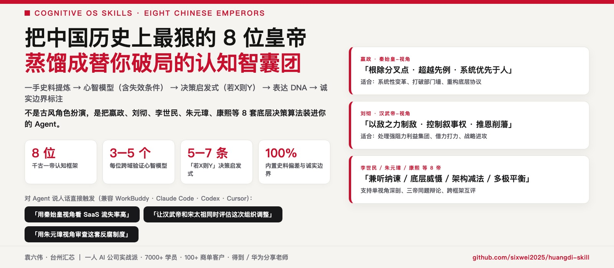
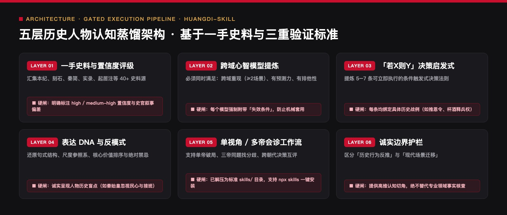

<div align="center">



# 中国历史八大皇帝 · 视角 Skills
### `huangdi-skill` · 基于《史记》《资治通鉴》《贞观政要》一手史料蒸馏的 8 套帝王认知决策框架

[](https://agentskills.io)
[](#四史料锚定与三级置信度红线)
[](#三三种高价值调用模式附实战指令)
[](LICENSE)

> 🔴 **作者：袁六伟 · 台州汇芯**｜一人 AI 公司创业者，学员 7000+，客户 100+，得到 / 华为分享老师  
> 📮 更多 AI 工具实测与自动化实战，关注 **公众号 / 视频号：袁六伟**

**不是穿龙袍说古装剧台词的「角色扮演玩具」，是把八位开国与盛世君主的底层决策算法蒸馏成可调用的认知操作系统。**  
每一个帝王 Skill 都严格基于正史本纪、诏令奏议与实录宝训提炼，包含 **5 大核心心智模型（含失效边界）**、**If-X-Then-Y 决策启发式**、**真实语言 DNA** 以及 **反脸谱化/反爽文伪史硬护栏**。当你面对组织分封、战略扩张、现金流危机或制度重构时，一键拉起跨越两千年的帝王内阁为你压力测试。

```bash
# 方式 A：通过 skills CLI 一键安装全部 8 个帝王视角（推荐）
npx skills add sixwei2025/huangdi-skill

# 方式 B：克隆仓库并复制到 Claude Code / WorkBuddy 技能目录
git clone https://github.com/sixwei2025/huangdi-skill.git
cp -R huangdi-skill/skills/* ~/.claude/skills/
```

[八大皇帝认知矩阵](#一八大皇帝认知矩阵总览) · [五层解构解剖图](#二每个帝王-skill-内部的五层认知解剖) · [三大调用模式](#三三种高价值调用模式附实战指令) · [一手史料与置信度](#四史料锚定与三级置信度红线) · [目录结构](#五仓库目录结构)

</div>

---

## 一、八大皇帝认知矩阵总览

| 帝王 Skill | 朝代与定位 | 核心决策算法（Mental Models） | 最适合用来审视什么现代问题？ | 独立源码入口 |
| :--- | :--- | :--- | :--- | :--- |
| **秦始皇** | 秦 · 制度奠基者 | 废分封行郡县、车同轨书同文、法家度量衡标准化、强干弱枝 | **集团标准化改造、收购后多团队强行并轨、消灭山头藩镇** | [`skills/秦始皇-视角/SKILL.md`](skills/秦始皇-视角/SKILL.md) |
| **汉武帝** | 西汉 · 战略进攻者 | 推恩令阳谋削藩、盐铁官营算缗财政、远交近攻主动出击、轮台罪己止损 | **激进业务扩张期的现金流汲取、削弱老臣山头、战略止损** | [`skills/汉武帝-视角/SKILL.md`](skills/汉武帝-视角/SKILL.md) |
| **隋文帝** | 隋 · 制度重构者 | 三省六部制分权、科举破门阀、大索貌阅清隐漏、开皇之治极度节俭 | **中后台流程再造、打破资历垄断选拔新人、账目清查反腐** | [`skills/隋文帝-视角/SKILL.md`](skills/隋文帝-视角/SKILL.md) |
| **唐太宗** | 唐 · 盛世治理者 | 兼听则明（魏徵式蓝军机制）、胡越一家开放生态、贞观慎刑与晚年克制难题 | **高管团队听取刺耳真话、开放生态联盟、成长期组织文化** | [`skills/唐太宗-视角/SKILL.md`](skills/唐太宗-视角/SKILL.md) |
| **宋太祖** | 北宋 · 风险拆弹专家 | 杯酒释兵权（利益置换兵权）、更戍法兵将分离、先南后北、收精兵制钱谷 | **联合创始人和平退出、防止核心销售/高管拥兵自重** | [`skills/宋太祖-视角/SKILL.md`](skills/宋太祖-视角/SKILL.md) |
| **成吉思汗** | 蒙古 · 极速征服者 | 千户制打碎旧部落、怯薛军精英孵化、战利品透明分配、驿站情报闪电战 | **游击队打败正规军、高激励分配机制、跨区域闪电扩张** | [`skills/成吉思汗-视角/SKILL.md`](skills/成吉思汗-视角/SKILL.md) |
| **朱元璋** | 明 · 草根风控极客 | 高筑墙广积粮缓称王、废丞相直管六部、鱼鳞图册黄册穿透监管、零容忍重典 | **创业早期低调攒现金流、穿透式供应链/财务稽核、防贪腐** | [`skills/朱元璋-视角/SKILL.md`](skills/朱元璋-视角/SKILL.md) |
| **康熙** | 清 · 复杂系统平衡者 | 三藩之乱定力博弈、密折制度多源交叉信息、永不加赋民生底线、中西算学格物 | **多利益集团复杂博弈、建立直达一线的情报网、长期主义接班** | [`skills/康熙-视角/SKILL.md`](skills/康熙-视角/SKILL.md) |

---

## 二、每个帝王 Skill 内部的五层认知解剖

<p align="center">
  
</p>

我们拒绝「用古风腔调讲现代鸡汤」。每个 `SKILL.md`（平均 300–450 行深度长文）均由以下 **5 层硬核结构** 组成：

1. **Layer 1 · 核心心智模型（5 大底层算法 + 失效边界）**  
   不仅写出他的成功杀招（如秦始皇的「标准化穿透管理」、汉武帝的「推恩令阳谋」），更明确写出 **这套算法在什么边界下会崩盘**（如秦始皇把战争动员律法原封不动搬进和平治世导致陈胜吴广起义；朱元璋废除丞相导致后世内阁与司礼监畸形博弈）。
2. **Layer 2 · 决策启发式（If-X-Then-Y 战时反应表）**  
   提炼 8–12 条面对具体危机时的条件反射：当地方诸侯/分公司阳奉阴违时怎么切？当国库/公司账面只剩 6 个月粮草时先砍哪条线？
3. **Layer 3 · 真实语言 DNA（基于诏令与奏对原文）**  
   拒绝电视剧里的「朕即天下」，还原史书里的真实说话习惯——例如朱元璋白话诏书的凌厉粗粝、唐太宗与侍臣算账时的反问对比、宋太祖喝酒摊牌时的直白算计。
4. **Layer 4 · 反模式护栏（Anti-Patterns）**  
   严禁洗白历史暴政与晚年昏招，严禁引用营销号伪史，严禁把残酷的封建集权权术无条件美化为现代企业管理圣经。
5. **Layer 5 · 诚实边界与三级史料置信度**  
   区分「正史铁证」「多源互证」「孤证存疑」，绝不替古人编造未发生过的心理活动。

---

## 三、三种高价值调用模式（附实战指令）

### 模式 A：单帝王深度问策（穿透业务难题）
> **指令示例**：  
> `调用【宋太祖-视角】分析一下：我们公司两个早期合伙人现在各自带一个事业部，尾大不掉、不服总部调配，但直接开除又会引发核心客户流失，怎么用赵匡胤的思路设计一套体面的「杯酒释兵权 + 更戍法」方案？`

### 模式 B：三帝王圆桌交锋（压力测试战略）
> **指令示例**：  
> `我们公司账上还有 300 万，现在面临两个选择：A 是趁对手虚弱全面烧钱抢市场，B 是砍掉新业务死守现金流。请同时拉起【汉武帝-视角】【朱元璋-视角】【唐太宗-视角】，让他们三人围绕这笔钱怎么花展开三轮辩论，并指出对方方案的死穴。`

### 模式 C：历史本纪复盘（跨朝代制度推演）
> **指令示例**：  
> `让【秦始皇-视角】和【隋文帝-视角】同台对话：为什么秦朝和隋朝都终结了数百年大分裂、创立了泽被后世的制度，却都在二世而亡？如果让他们互相给对方挑 3 个致命制度漏洞，他们会怎么说？`

---

## 四、史料锚定与三级置信度红线

| 置信度等级 | 史料来源层级 | 在 Skill 输出中的使用规范 |
| :---: | :--- | :--- |
| **L1 · 核心铁证** | 《史记》《汉书》《旧唐书》《明太祖实录》《贞观政要》收录的原始诏令、律令条文、明确纪年制度 | 可直接作为核心心智模型与决策依据引用 |
| **L2 · 多源互证** | 《资治通鉴》司马光考异采信的君臣奏对、多部笔记史料共同印证的朝堂博弈细节 | 可作为性格特质与启发式案例，必要时说明语境 |
| **L3 · 孤证/演义** | 单一野史孤证、后世文人托名演义（如民间流传的夸张对联或演义台词） | **严禁作为事实依据**；若因俗语借喻提及，必须显式标注「此乃后世演义/孤证」 |

---

## 五、仓库目录结构

```text
huangdi-skill/
├── README.md                             # 仓库总览与三模式调用指南
├── 中国历史八大皇帝-视角Skills.zip          # 一键打包归档（供手动导入客户端使用）
├── skills/
│   ├── 秦始皇-视角/SKILL.md               # 秦始皇认知操作系统
│   ├── 汉武帝-视角/SKILL.md               # 汉武帝认知操作系统
│   ├── 隋文帝-视角/SKILL.md               # 隋文帝认知操作系统
│   ├── 唐太宗-视角/SKILL.md               # 唐太宗认知操作系统
│   ├── 宋太祖-视角/SKILL.md               # 宋太祖认知操作系统
│   ├── 成吉思汗-视角/SKILL.md             # 成吉思汗认知操作系统
│   ├── 朱元璋-视角/SKILL.md               # 朱元璋认知操作系统
│   └── 康熙-视角/SKILL.md                 # 康熙认知操作系统
└── assets/showcase/                      # 首屏横幅与五层认知蒸馏架构图
```

---

## 关于作者与开源生态

**袁六伟 · 台州汇芯**：一人 AI 公司创业者，学员 7000+，服务商单客户 100+，覆盖近 20 个行业，得到 / 华为分享老师。AI 变现实战派，自己跑通才拿出来教。

- 公众号：**袁六伟**（微信搜一搜关注，看更多 AI 工具实测与一人公司实战）
- 视频号：**袁六伟**

这个项目免费开源。如果它帮你的产线省下了每天反复返工的时间，欢迎在右上角点个 ⭐ **Star**，也欢迎转发给身边做内容或一人公司的朋友。

### 同系列开源 Skill 矩阵（袁六伟 · 台州汇芯）

| 仓库 | 领域 | 核心能力 |
| :--- | :--- | :--- |
| [**workbuddy-wechat-autopilot**](https://github.com/sixwei2025/workbuddy-wechat-autopilot) | 公众号全链路 | 九步硬闸总控：选题→写稿→真实截图→6套封面→6套排版→三重校验→草稿箱 |
| [**wechat-cover-skill**](https://github.com/sixwei2025/wechat-cover-skill) | 公众号视觉 | 封面渲染引擎（6套高客单价杂志风 + 黑红金 v2b + DOM 几何硬闸） |
| [**gzh-million-layout-skill**](https://github.com/sixwei2025/gzh-million-layout-skill) | 公众号排版 | 汇芯红 `#C8102E` 六套 100% 内联 CSS 骨架 + 乱码硬闸 + 配图皮肤 |
| [**ai-tool-review-wechat-skill**](https://github.com/sixwei2025/ai-tool-review-wechat-skill) | 公众号评测 | AI 工具真跑评测工作流（5项一票否决 + 说人话硬闸 + 证据表） |
| [**hit-title-expert-skill**](https://github.com/sixwei2025/hit-title-expert-skill) | 爆款标题 | 一次直出 10 条 14–22 字高浓缩狠标题（5大公式 × 5类钩子词） |
| [**auto-tutorial-skill**](https://github.com/sixwei2025/auto-tutorial-skill) | 短视频工程 | 链接/网页/真机截图 → 3:4 封面 + 1.5x 配音 + 红框标注教程视频 |
| [**talking-head-video-skill**](https://github.com/sixwei2025/talking-head-video-skill) | 短视频工程 | 1080×1920 竖屏真人口播短视频（ASR 错字校对 + 逐字卡拉OK字幕 + 6项QC） |
| [**3d-map-video-skill**](https://github.com/sixwei2025/3d-map-video-skill) | 短视频工程 | MapLibre 3D 地形 + WarFX 战争特效（粒子行军/点阵兵力/震屏混音） |
| [**psych-kepu-video-skill**](https://github.com/sixwei2025/psych-kepu-video-skill) | 短视频工程 | Remotion + JSON 驱动的 15–30s 深色扁平动画心理科普短视频 |
| [**dark-infographic-video-skill**](https://github.com/sixwei2025/dark-infographic-video-skill) | 短视频工程 | 纯 Python + FFmpeg 暗黑流光数据可视化科普片（含 v2 手机外放配乐） |
| [**local-video-hub**](https://github.com/sixwei2025/local-video-hub) | AI 团队基建 | 视频版本地 Obsidian：多 AI 员工统一交片、去重门闸与四态流转云台 |
| [**yuanliuwei-ai-skills**](https://github.com/sixwei2025/yuanliuwei-ai-skills) | 一人公司方法 | PACT 72h 需求验证模型与一人 AI 公司 10 大业务决策模块 |
| [**book-skill**](https://github.com/sixwei2025/book-skill) | 知识工程 | 上传任意书籍 PDF → 自动提炼方法论生成 `.skill` + 公众号导流文案 |
| [**huangdi-skill**](https://github.com/sixwei2025/huangdi-skill) | 认知操作系统 | 中国历史八大皇帝（秦始皇/汉武帝/唐太宗等）一手史料认知框架蒸馏 |
| [**sunrise-tracker**](https://github.com/sixwei2025/sunrise-tracker) | 选题雷达 | 小红书 AI 赛道 10 倍异常流量「低粉爆文」每日早 7 点监测推送 |
